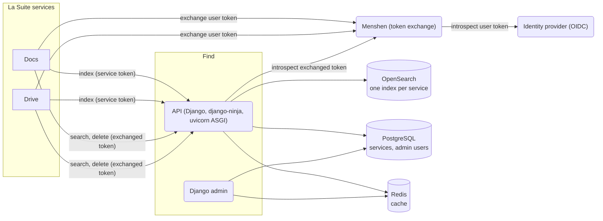
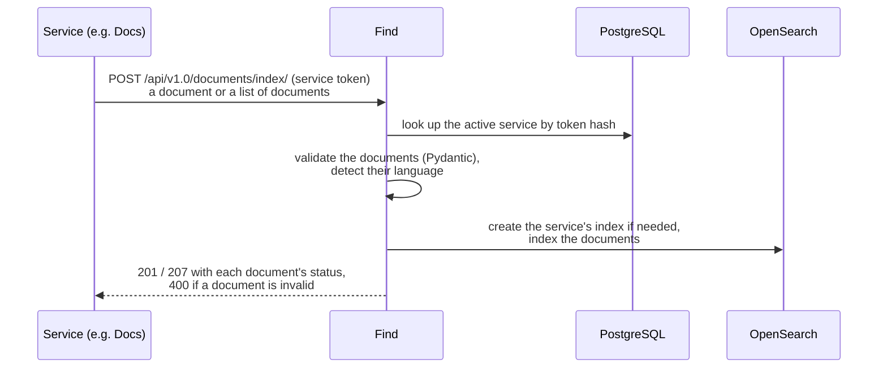
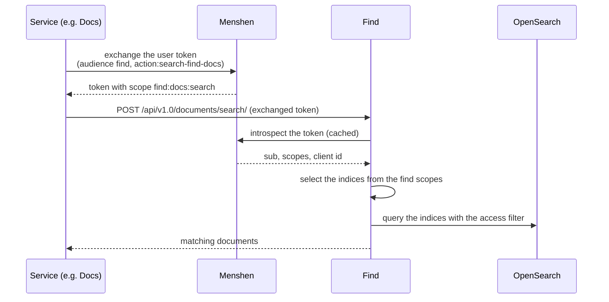

## Architecture

Find indexes the documents of La Suite services (e.g. Docs, Drive) in
OpenSearch and lets their users search them across services. It is an API
called by the services' backends, with no frontend. The decisions behind this
architecture are recorded in [ADR-0001](adr/ADR-0001-20261019-async-django-ninja-and-menshen.md).

### Components

- **API**: three async endpoints under `/api/v1.0/documents/` (`index/`,
  `search/`, `delete/`), served by uvicorn workers. Their OpenAPI schema and
  documentation can be enabled with `API_OPENAPI_ENABLED` and
  `API_DOCS_ENABLED`.
- **Admin**: registers the services and gives them their token, and runs the
  self-tests (`/admin/selftest/`). Its static files are served by ServeStatic.
- **OpenSearch** stores the documents, one index per service:
  `{OPENSEARCH_INDEX_PREFIX}-{service name}`.
- **PostgreSQL** stores the registered services, with the hash of their token,
  and the admin users.
- **Redis** is the cache: introspection results and admin sessions.

### Indexing

A service indexes its documents with its service token. It may only write to
its own index.

The language of each document is detected (py3langid). Its title and content
are stored in language-specific fields (`title.fr`, `content.en`, …) analyzed
for that language, plus trigram fields that tolerate typos. A bulk request
indexes nothing if any document fails validation.

### Search and delete

Search and delete act on behalf of a user. The service exchanges the user's
access token with Menshen for a token targeting Find, by requesting an action
scope; Menshen grants it as `find:<service>:search` or
`find:<service>:delete` scopes.

- **Scopes select the indices.** A search covers every service granted by a
  `find:<service>:search` scope, or only the requested `services`, which must
  all be granted (400 otherwise). A delete runs on the requested `service`,
  which a `find:<service>:delete` scope must grant. A token with no applicable
  scope gets a 403. Which service may search which is configured in Menshen's
  action scopes, not in Find.
- **The access filter selects the documents** inside these indices, in the
  OpenSearch query itself. A user sees the active documents that list their
  `sub` in `users`, or that are not restricted and whose id the service sends
  in `visited`. Group access is not implemented yet. A user may only delete
  documents that list their `sub` in `users`.
- **Introspection results are cached** in Redis for
  `MENSHEN_INTROSPECTION_CACHE_TTL` seconds: an accepted token never beyond
  its expiration, a rejected token for the whole duration, as it cannot become
  valid again. A token Menshen rejects gets a 401; Menshen being unavailable, a
  503, which is not cached.

See [setup-indexer.md](setup-indexer.md) for the configuration of Find, and
[setup-menshen.md](setup-menshen.md) for a local Menshen.
